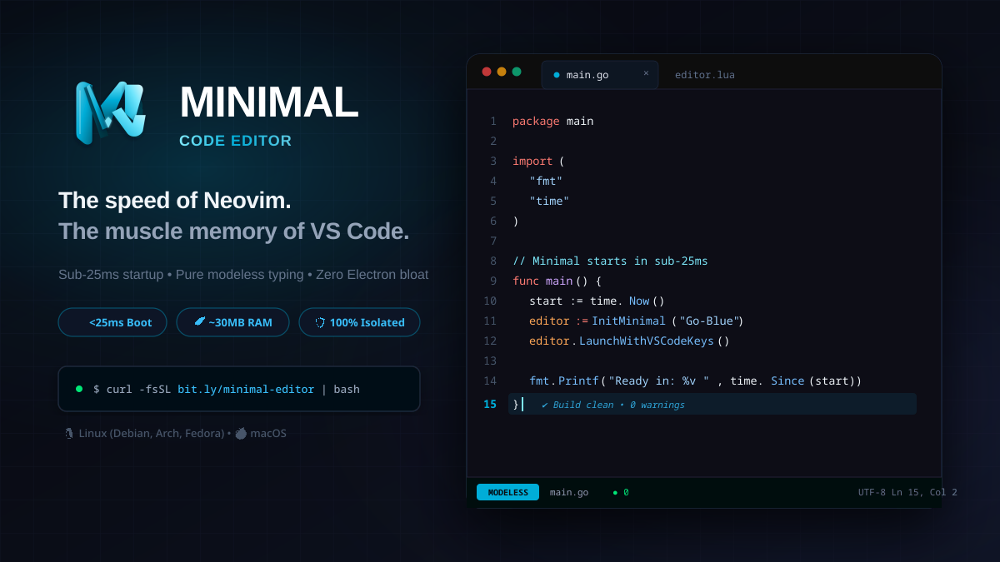

# Minimal Code Editor

<p align="center">
  
</p>

**Minimal** is a lightning-fast, distraction-free code editor combining the raw speed of Neovim with the familiar 1-to-1 muscle memory of VS Code. Built for developers who want instantaneous startup, modeless typing, zero Electron bloat, and standard cross-platform keybindings across Linux, Windows, and macOS.

---

## ⚡ Key Highlights

- **Sub-25ms Startup:** Memory footprint under ~30MB with zero Electron overhead.
- **Modeless Typing:** Starts directly in write mode—no Vim mode hurdles. Press <kbd>Esc</kbd> to enter Normal mode cleanly with zero key leakage.
- **1-to-1 VS Code Keybindings:** Exactly one sensible shortcut per operation (<kbd>Ctrl+S</kbd>, <kbd>Ctrl+P</kbd>, <kbd>Ctrl+F</kbd>, <kbd>Ctrl+H</kbd>, <kbd>Ctrl+W</kbd>, <kbd>Ctrl+Q</kbd> on Linux/Windows; native <kbd>Cmd ⌘</kbd> on macOS).
- **Smart Code Suggestions:** Powered by `blink.cmp` with intelligent multi-source completions (LSP, friendly-snippets, file paths, and buffer words).
- **Out-of-the-Box Multi-Language Support:** First-class syntax highlighting and LSP intelligence for **Go**, **Python**, **JavaScript/TypeScript/React/TSX**, **HTML**, **CSS**, **Tailwind CSS**, **Rust**, **C/C++**, **Lua**, **Bash**, **YAML**, and **JSON**.
- **100% Isolated & Safe:** Runs under an isolated `NVIM_APPNAME="vsc"` sandbox. It will **never** alter or interfere with your existing Neovim, Kitty, or desktop environment setups.
- **Self-Updating:** Keep Minimal cutting-edge with a single command: `minimal update`.

---

## 📦 Prerequisites

Minimal requires **Neovim** (>= 0.10.0, recommended 0.11+) and **Git**. On Linux, it runs inside an optimized **Kitty** terminal window.

### Windows (Native PowerShell)
```powershell
winget install Neovim.Neovim Git.Git
```

### macOS (via Homebrew)
```bash
brew install neovim kitty git
```

### Linux
- **Arch Linux / Manjaro / EndeavourOS:**
  ```bash
  sudo pacman -S neovim kitty git
  ```
- **Ubuntu / Debian / Linux Mint:**
  ```bash
  sudo apt install neovim kitty git
  ```
- **Fedora:**
  ```bash
  sudo dnf install neovim kitty git
  ```

*(Recommended)* Install a Nerd Font such as **JetBrainsMono Nerd Font** for clean icons and status glyphs.

---

## 🚀 Installation & Update

### Universal Linux & macOS Installer
Run in your terminal:
```bash
curl -fsSL https://raw.githubusercontent.com/utkarshIsAProgrammer/minimal-code-editor/main/install.sh | bash
```

### Native Windows PowerShell Installer
Run in PowerShell:
```powershell
irm https://raw.githubusercontent.com/utkarshIsAProgrammer/minimal-code-editor/main/install.ps1 | iex
```

### Updating Minimal
Whenever a new feature or fix lands, update seamlessly from your terminal:
```bash
minimal update
# or
msc update
```

---

## 💻 How to Use

Launch Minimal from anywhere in your terminal or app launcher:

```bash
minimal             # Opens homescreen / empty workspace
minimal .           # Opens current folder as workspace
minimal main.py     # Opens specific file
```

---

## ⌨️ Essential Shortcuts

| Action | Linux & Windows | macOS (`Cmd` / `⌘`) | Description |
| :--- | :--- | :--- | :--- |
| **Normal Mode** | <kbd>Esc</kbd> | <kbd>Esc</kbd> | Closes menus/suggestions and enters Normal mode |
| **Write Mode** | <kbd>i</kbd> | <kbd>i</kbd> | Starts typing right where cursor is |
| **Save File** | <kbd>Ctrl</kbd>+<kbd>S</kbd> | <kbd>⌘</kbd>+<kbd>S</kbd> | Saves current file |
| **Save As** | <kbd>Ctrl</kbd>+<kbd>Shift</kbd>+<kbd>S</kbd> | <kbd>⌘</kbd>+<kbd>Shift</kbd>+<kbd>S</kbd> | Prompts for path/name |
| **Close Tab** | <kbd>Ctrl</kbd>+<kbd>W</kbd> | <kbd>⌘</kbd>+<kbd>W</kbd> | Closes active tab |
| **Quit Minimal** | <kbd>Ctrl</kbd>+<kbd>Q</kbd> | <kbd>⌘</kbd>+<kbd>Q</kbd> | Prompts to save dirty files and exits cleanly |
| **Open File (Quick Open)** | <kbd>Ctrl</kbd>+<kbd>P</kbd> | <kbd>⌘</kbd>+<kbd>P</kbd> | Fuzzy-search files in workspace |
| **Open Folder** | <kbd>Ctrl</kbd>+<kbd>O</kbd> | <kbd>⌘</kbd>+<kbd>O</kbd> | Select or type any folder path to open as workspace |
| **Command Palette** | <kbd>Ctrl</kbd>+<kbd>Shift</kbd>+<kbd>P</kbd> | <kbd>⌘</kbd>+<kbd>Shift</kbd>+<kbd>P</kbd> | Fuzzy-search all editor commands |
| **Toggle Sidebar** | <kbd>Ctrl</kbd>+<kbd>B</kbd> | <kbd>⌘</kbd>+<kbd>B</kbd> | Opens/closes Explorer file tree |
| **Toggle Terminal** | <kbd>Ctrl</kbd>+<kbd>`</kbd> | <kbd>⌘</kbd>+<kbd>`</kbd> | Opens embedded terminal |
| **Toggle Line Comment** | <kbd>Ctrl</kbd>+<kbd>/</kbd> | <kbd>⌘</kbd>+<kbd>/</kbd> | Toggles single or multiline comments |
| **Toggle Block Comment**| <kbd>Shift</kbd>+<kbd>Alt</kbd>+<kbd>A</kbd> | <kbd>Shift</kbd>+<kbd>⌥</kbd>+<kbd>A</kbd> | Toggles block comments (`/* */`, `<!-- -->`) |
| **Find in File** | <kbd>Ctrl</kbd>+<kbd>F</kbd> | <kbd>⌘</kbd>+<kbd>F</kbd> | Search text in current file |
| **Replace in File** | <kbd>Ctrl</kbd>+<kbd>H</kbd> | <kbd>⌘</kbd>+<kbd>H</kbd> | Find and replace in current file |
| **Find in Files (Grep)**| <kbd>Ctrl</kbd>+<kbd>Shift</kbd>+<kbd>F</kbd> | <kbd>⌘</kbd>+<kbd>Shift</kbd>+<kbd>F</kbd> | Search across all project files |
| **Replace in Files** | <kbd>Ctrl</kbd>+<kbd>Shift</kbd>+<kbd>H</kbd> | <kbd>⌘</kbd>+<kbd>Shift</kbd>+<kbd>H</kbd> | Project-wide search and replace |
| **Multi-Cursor Match** | <kbd>Ctrl</kbd>+<kbd>D</kbd> | <kbd>⌘</kbd>+<kbd>D</kbd> | Add selection to next match |
| **Quick Fix / Solutions**| <kbd>Ctrl</kbd>+<kbd>.</kbd> *(or <kbd>Alt</kbd>+<kbd>Enter</kbd>)* | <kbd>⌘</kbd>+<kbd>.</kbd> | LSP code actions, imports & autocorrect |
| **Format Document** | <kbd>Shift</kbd>+<kbd>Alt</kbd>+<kbd>F</kbd> | <kbd>Shift</kbd>+<kbd>⌥</kbd>+<kbd>F</kbd> | Formats buffer code |
| **Run Current File** | <kbd>F5</kbd> | <kbd>F5</kbd> | Executes active code file |
| **Color Theme Picker** | <kbd>Ctrl</kbd>+<kbd>K</kbd> <kbd>Ctrl</kbd>+<kbd>T</kbd> | <kbd>⌘</kbd>+<kbd>K</kbd> <kbd>⌘</kbd>+<kbd>T</kbd> | Selects theme |
| **Cycle Theme** | <kbd>F10</kbd> | <kbd>F10</kbd> | Dark Magic → Nerd Dark → Cyber Aurora |

📖 For the full keybindings manual, refer to **[docs/shortcuts.md](docs/shortcuts.md)** or the **[Printable PDF Cheatsheet](docs/shortcuts.pdf)**.

---

## 🗑️ Clean Uninstallation

Minimal is completely isolated. To uninstall:

```bash
cd minimal-code-editor && ./uninstall.sh
```

---

## 📄 License

This project is open-source under the MIT License.
